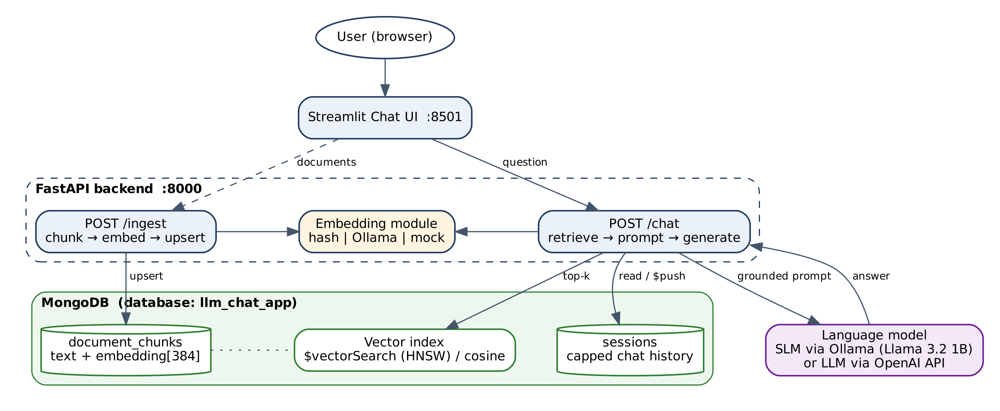

# NoSQL Databases using MongoDB — Lab Record & Mini Project

| | |
|---|---|
| **Student** | Manoranjan R (USN 24BTRCL117) |
| **Programme** | B.Tech – Artificial Intelligence and Machine Learning, Semester V |
| **Institution** | JAIN (Deemed-to-be University), Faculty of Engineering and Technology, Bengaluru |
| **Subject** | NoSQL Databases using MongoDB (Lab) |
| **Faculty** | Sujeet S Jagtap |
| **Academic year** | 2026 – 2027 |

This repository has everything for the MongoDB Lab: the code for all 18 lab experiments, the mini project (an LLM/SLM-backed RAG chat app on MongoDB) and both reports.

## Reports

| Report | PDF | Word |
|---|---|---|
| Lab Experiments Report (Chapters 1–18, one page each) | [reports/Lab_Experiments_Report.pdf](reports/Lab_Experiments_Report.pdf) | [docx](reports/Lab_Experiments_Report.docx) |
| Mini Project Report | [reports/Mini_Project_Report.pdf](reports/Mini_Project_Report.pdf) | [docx](reports/Mini_Project_Report.docx) |

## Repository layout

```
├── chapter-01 … chapter-18/   Lab experiments (2 activities per chapter) + chapter README
├── config/connection.py       Shared MongoDB connection helper used by every lab
├── setup/                     Environment setup notes
├── mini-project/              Mini project: LLM/SLM RAG chat application on MongoDB
│   ├── app/                   FastAPI backend (chat_api.py, embeddings.py, llm.py)
│   ├── frontend/              Streamlit chat UI + operations dashboard (Ch 7 + 14) with AI chat box
│   ├── data/                  Knowledge base + 24 labelled evaluation questions
│   ├── eval/                  Retrieval quality and scaling evaluations (+ results JSON)
│   ├── tests/                 pytest end-to-end tests (mongomock, no server needed)
│   ├── deploy/                Atlas Vector Search index definition
│   ├── Dockerfile, docker-compose.yml, .env.example
├── docs/diagrams/             Block diagrams and charts used in the reports
└── reports/                   Both reports (PDF + DOCX)
```

## Lab experiments

| # | Experiment | Folder |
|---|---|---|
| 1 | Why NoSQL? Foundations and the Database Landscape | [chapter-01](chapter-01) |
| 2 | Cloud Computing Primer and Environment Setup | [chapter-02](chapter-02) |
| 3 | MongoDB Data Model Fundamentals | [chapter-03](chapter-03) |
| 4 | Mastering Queries – CRUD and the Query Language | [chapter-04](chapter-04) |
| 5 | Aggregation Framework and Advanced Querying | [chapter-05](chapter-05) |
| 6 | Indexing Strategies and Performance Tuning | [chapter-06](chapter-06) |
| 7 | MongoDB Architecture Deep Dive | [chapter-07](chapter-07) |
| 8 | Replication and High Availability | [chapter-08](chapter-08) |
| 9 | The CAP Theorem in Practice | [chapter-09](chapter-09) |
| 10 | Transactions, Atomicity and Durability | [chapter-10](chapter-10) |
| 11 | Sharding and Horizontal Scalability | [chapter-11](chapter-11) |
| 12 | Database Security and the CIA Triad | [chapter-12](chapter-12) |
| 13 | Deploying MongoDB with Containers and the Cloud | [chapter-13](chapter-13) |
| 14 | Managing Database Services in Production | [chapter-14](chapter-14) |
| 15 | Designing a MongoDB-Backed Product as a Service | [chapter-15](chapter-15) |
| 16 | Wide-Column and Graph Databases – Cassandra and Neo4j | [chapter-16](chapter-16) |
| 17 | AI-Native MongoDB – Vector Search and RAG Foundations | [chapter-17](chapter-17) |
| 18 | Comparative Capstone Lab | [chapter-18](chapter-18) |

### Running the labs

```bash
pip install -r requirements.txt
docker run -d -p 27017:27017 --name mongo mongo:7
cp .env.example .env
python chapter-02/lab_01_setup_environment.py      # check the environment first
python chapter-02/lab_02_bookstore_crud.py
```

Chapters 8–10 and 13 need a replica set (`bash chapter-08/lab_01_deploy_replicaset.sh`). Each chapter's README lists its own prerequisites.

## Mini project — LLM/SLM-backed chat application on MongoDB

MongoDB does three jobs in this app: it stores the knowledge base (`document_chunks`), acts as the vector store (Atlas `$vectorSearch`/HNSW, or brute-force cosine on a local server) and keeps the conversation memory (`sessions`). Answers come from a **Small Language Model** (default `llama3.2:1b` via Ollama, running locally) or from a **Large Language Model** (OpenAI). If no model can be reached, the app falls back to an extractive answer.



```bash
cd mini-project
docker compose up -d --build
docker compose exec ollama ollama pull llama3.2:1b
docker compose exec backend python scripts/ingest.py
# open http://localhost:8501   (chat)
# open http://localhost:8502   (Chapter 7 + 14 operations dashboard with the AI chat box)
```

Without Docker: `pip install -r requirements.txt`, start MongoDB and Ollama, then run `uvicorn app.chat_api:app --reload`, `python scripts/ingest.py` and `streamlit run frontend/streamlit_app.py`.

Tests and evaluation (no MongoDB server needed):

```bash
cd mini-project
pytest -q                          # 14 passed
python -m eval.retrieval_eval      # Hit@1 / Hit@3 / MRR per embedding backend
python -m eval.scaling_eval        # retrieval latency vs corpus size
```

| Embedding backend | Hit@1 | Hit@3 | MRR |
|---|---|---|---|
| MD5 mock (textbook Appendix A) | 0.042 | 0.375 | 0.181 |
| Feature hashing (this project) | 0.958 | 1.000 | 0.979 |

What changed from the textbook's Appendix A reference app:
- Real offline embeddings (feature hashing) replace the random MD5-seeded vectors, so retrieval now finds relevant chunks
- SLM by default, with LLM and extractive fallback backends
- Idempotent ingest: chunks are upserted on `(source_title, chunk_index)`, so re-ingesting doesn't duplicate them
- Atomic conversation history updates (`$push` + `$slice`) instead of a read-modify-write race
- An Atlas `$vectorSearch` retrieval path, with its index definition included
- Fixed the Dockerfile module path (the old one had a hyphen, so it couldn't be imported) and the Streamlit session id
- Added 4-service Compose (Mongo + Ollama + backend + frontend), tests and evaluations

## Credits

The lab experiment scripts (chapter-01 … chapter-18, `config/`) come from the companion repository of *NoSQL Databases Using MongoDB* by Sujeet Jagtap — <https://github.com/sujeetjagtap/NoSQL-Databases-using-MongoDB> — and are used here as the course's prescribed lab code under its GPL-3.0 licence. The mini project builds on that book's Appendix A. This repository is distributed under the same GPL-3.0 licence ([LICENSE](LICENSE)).
